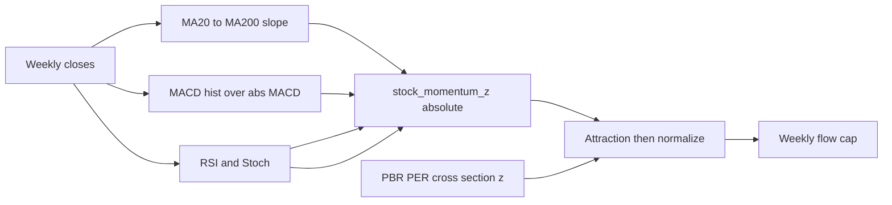

# 모멘텀 지표를 주문에 실제로 반영하기

지표 계산 자체([main.py](main.py)의 `stock_oscillator_pack`, `stock_momentum_z`)는 돌아가고 있다. 인구 종목 점수는 모멘텀 가중 하한이 0.62라서 숫자만 보면 커 보인다. 그런데 그 z가 종목 순위를 거의 안 바꾸고, 주간 매매 한도에 삼켜진다.

## 왜 영향이 작은가

- **공통 요인만 잡힌다.** PBR·PER·MOS는 `ib_cs_zscore`로 같은 나라 종목끼리 순위를 매긴다. `stock_momentum_z`는 종목 절대값(−2~+2)이다. 시장이 같이 오르면 전 종목 z가 비슷하고, `normalize_portfolio_weights`에서 그 공통분은 사라진다.
- **긴 이평이 추세를 지배한다.** `STOCK_TREND_MA_PERIODS = (20, 60, 120, 200)`이고 가중치는 기간 길이에 비례한다. MA200이 있으면 추세 점수의 절반이다. 종목별 최근 흐름은 묻힌다. 이력 부족이면 기울기는 중립(0.5)이라 z도 0이다.
- **MACD는 교차한 그 주에만 크다.** `z_macd = hist / |macd|`. 추세가 자리 잡으면 히스토그램이 줄고 교차는 0이라, 가중 0.30~0.34가 대부분 주에서 0에 가깝다. 골든/데드크로스의 `POP_CROSS_MOM_Z`(0.55)와 속도 1.65배도 그 한 주만 적용된다.
- **RSI가 추세와 과열을 동시에 한다.** `(rsi-50)/25`로 추세 z에 더해지고, RSI>70이면 `stock_profit_taking_mod`로 z와 종목 점수에서 다시 뺀다. 강한 상승일수록 두 항이 상쇄된다.
- **속도 채널도 작다.** 매수 기본 속도 0.08에 모멘텀 최대 약 1.7배여도, 리밸런스 데드밴드 4%와 주간 유량 상한 12.5% 안에 들어간다.
- **만들어 두고 안 쓰는 경로.** `pop_stock_is_overheated`, `stock_issuer_market_signal_score`는 호출처가 없다. 주가 모멘텀은 밸류 프로필에만 있고 종목 점수에는 안 들어간다.

## 쓰는 방법

역할을 둘로 나눈다. 가중치를 키우는 것만으로는 공통 요인이 정규화에서 지워진다.

**1. 종목 순위용 추세 (누가 상대적으로 강한가)**

`stock_momentum_z` 안에서 RSI·스토캐스틱·차익실현 감점을 뺀다. 순위 입력은 아래로만 만든다.

- 4주·13주 가격 수익률 (`stock_price_series`)
- 짧은 이평 기울기 (5·20·60). 120·200은 부호 필터로만 두고 크기 가중에서는 뺀다
- MACD는 `hist / 가격`으로 두어, 추세가 이어지는 동안 크기가 남게 한다
- 골든/데드크로스는 발생 주만 ±0.55가 아니라 이후 4주 동안 감쇠 (1.0, 0.6, 0.35, 0.15)

이 원시값을 국가 유니버스에서 `ib_cs_zscore`한 뒤, 지금처럼 `w_mom * z_mom`으로 넣는다. 호출부는 `_pop_stock_name_scores_compute`와 `ib_stock_name_scores_for_universe` (그리고 폴백 `ib_opportunity_stock_score`). 인구 모멘텀 하한 0.62와 IB 국면 가중은 유지한다. 입력이 종목 간 z가 되면, IB 펀더멘털 국면의 mom 0.05도 동점 순위에는 작동한다.

**2. 타이밍용 오실레이터 (언제 사고팔까)**

RSI·스토캐스틱은 종목 점수에 더하지 않는다. 이미 있는 `stock_profit_taking_mod` / `stock_oversold_bounce_mod`만 `pop_retail_trading_speeds`에서 매수·매도 속도를 조절하게 둔다. `stock_momentum_z`와 종목 raw 점수에 있는 차익실현 이중 감점(`z -= 2*pt`, `raw -= 0.25*pt`)은 점수 쪽에서 제거한다.

과열 플래그는 극단에서만 게이트로 쓴다. RSI>70 또는 스토캐스틱>80이면 골든크로스가 아닌 신규 매수를 늦추고, RSI<30이면 매도 속도를 낮춘다. `pop_stock_is_overheated`를 매수 전면 차단에 연결하지는 않는다. 밸류 고평가(PBR/PER)와 묶여 있어 모멘텀과 별개인 매수를 같이 막는다.

## 건드리지 않는 것

- 채권 가격 모멘텀 (`pop_retail_bond_trading_speeds`)
- 공정가치 축. 모멘텀은 계속 밸류와 분리한다
- 인구·IB 국면 테이블의 mom 가중 숫자. 먼저 입력의 종목 간 분산을 살린다
